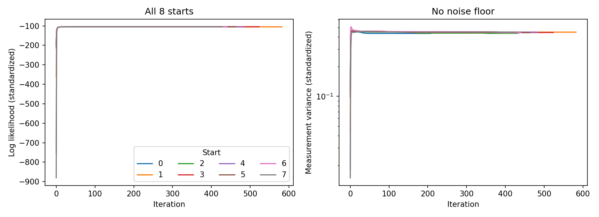
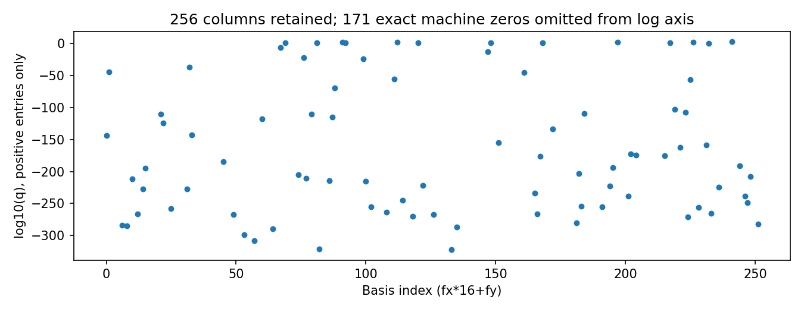

# 2025 Enhanced SR-Kriging 단일 실행 결과

검토일: 2026-10-11 KST. 결과 폴더의 20261010T161459Z는 UTC 생성 시각이다.
전체 원문 대비 수식/함수/shape 설명: ../../SINGLE_2025_README.md

## 실행 상태

- 수학적 테스트: 11/11 통과.
- 실제 데이터: 183개 원 관측소 -> 좌표별 평균 88개 학습 위치. 외부 위치 27개.
- 실제 데이터 smoke: 88개/256기저에서 20회 갱신 및 독립 검증 통과. 수렴 실험으로 해석하지 않음.
- 전체 학습: 8개 시작 모두 수렴. 학습 likelihood로 start 2(0부터 번호)를 선택.
- 독립 공분산/likelihood/예측 검증과 저장 파일 재검증 통과.
- 기존 핵심 소스의 전후 SHA256 일치. 기존 Adaptive 및 baseline 캐시 변경 없음.

## 단일 결과

| 항목 | 값 |
|---|---|
| Snapshot | 2024-08-01 12:00 KST |
| 학습 / 외부 위치 | 88 / 27 |
| 평가 포함 / 제외 | 21 / 6 |
| Grid / 초기 기저 수 | 16x16 / 256 |
| 측정오차 분산, 표준화 단위 | 0.436175239831857 |
| 측정오차 분산, 원 nins 단위 제곱 | 43260.2283293 |
| 측정오차 표준편차, 원 nins 단위 | 207.990933286 |
| MAE, 원 nins 단위 | 393.595407558 |
| RMSE, 원 nins 단위 | 536.523071687 |
| 표준화 반응 log-likelihood | -104.150773534139 |
| 원 단위 log-likelihood (Jacobian 반영) | -610.357580914134 |
| 선택된 시작의 반복 수 | 433 |
| 마지막 절대 likelihood 변화 | 8.59311910517e-09 |
| 학습 시간, 8개 시작 포함 | 6.142024초 |
| Cy condition number | 82.4144907368 |

coord1 범위: [-2.1428982355631514, 1.0096712796222858].
coord2 범위: [-0.7160546445008505, 1.0874630893739489].
반응 평균 805.5869713834653, population SD 314.929902987464.
학습 nins 범위 [170.415335, 1257.413333].
원 물리 단위와 좌표 익명화/변환의 역변환은 확인되지 않았다. km 또는 W/m²라고 확정하지 않았다.

27개 중 23개는 학습 사각형 안에서 예측이 정의된다. 그중 hull 밖 2개는
MAE/RMSE에서 제외했다. 나머지 4개는 사각형 밖이라 예측값을 NaN으로 저장했다.
NaN은 모델 실패 대체값이 아니라 명시적으로 정의하지 않은 외부 영역이다.
평가되는 21개에는 결측·비유한 예측이 없다.

## 수치 상태와 희소성

임의 threshold 없이 256개 열을 유지했다. 선택 해의 q 배열 중 정확히 0은
171개이며 floating-point underflow 결과다.
최소 양수 q=5e-323, 최대 q=635.747300817.
사분위수 [0,25,50,75,100]%: [0.0, 0.0, 0.0, 4.5541892796411724e-256, 635.7473008166525].
이 수치를 유효 기저 수로 재정의하거나 기저 선택에 사용하지 않았다.
basis_variances.npy는 float64 원본 배열이고 CSV에는 원 단위 분산도 있다.

추가 jitter/noise floor/variance clipping/pruning은 모두 없다.
최종 조건수는 82.41이며 고정된 기존 기준상 70자리 재평가가 필요하지 않았다.
독립 검증 차이(표준화 단위):
likelihood 1.421e-14,
예측평균 최대 1.954e-14,
분산 최대 3.553e-15.
기존 rtol=atol=1e-7을 완화하지 않았다.

각 시작의 반복 likelihood 감소는 없었다. 그러나 최종 likelihood의
최대-최소 차이는 0.615504686045이다.
따라서 선택 해는 시도한 8개 수렴점 중 가장 높은 학습 우도의 해이며,
전역최적 또는 초기값 독립성이 확인된 해라는 주장은 하지 않는다.

## 논문 충실성과 적용 범위

2025 원문 식 (1)-(3), (8)-(12), (16), (20)과 p5 갱신 순서/종료조건을
직접 확인했다. 기존 observation-space 식이 직접 coefficient-space 계산과 일치했다.
핵심 수학 변경 없이 별도 실행기·검증을 추가했다.

16x16 grid, DCT-II tensor, bilinear 연산자, 학습 반응 표준화와
다중 초기값 예산은 application-specific choices다.
2025년 논문의 1D 실험 자체를 복제한 결과라고 부르지 않는다.
2026년의 tensor 구조를 참고했으나 Bayesian Gibbs는 구현하지 않았다.

latent_variance는 고정 추정 모수의 잠재장 분산, observation_variance는
그 값에 추정 iid 측정오차 분산을 더한 것이다. 전체 Bayesian 예측분산은 아니다.
좌표별 평균은 원 관측 수가 서로 다르며, 이번 iid noise 추정값을
단일 센서 자체의 순수 오차 분산이라고 단정할 수 없다.

성능 경쟁이나 개선을 목표로 재적합·튜닝하지 않았다. 이번 MAE/RMSE는
지정된 단일 스냅샷과 21개 평가 위치에서의 실행 결과이다.

## 파일

- tests.txt/json: 테스트 이름과 결과.
- data_audit.json / training_used.csv: 학습 데이터 검사·원본 해시·사용 위치.
- transform.json / manifest.json: 변환, 설정, seed, 원문 및 소스 해시.
- smoke_trace.csv / smoke.json: 20회 smoke 갱신과 audit.
- fit.json / starts.csv / likelihood_trace.csv: 선택 해 및 모든 시작의 기록.
- basis_variances.npy/csv: 원본 q와 주파수별 분산.
- predictions_all.csv: 27개 위치 전체, hull/정의 여부 및 평균·분산·표준편차.
- evaluation.csv: 21개 평가 위치의 실제값·예측값·절대오차.
- prediction_audit.json / saved_output_audit.json: 독립 검증 및 저장값 재검증.
- result.json: 기계 판독용 최종 요약.
- convergence.png / basis_variances.png: 수렴과 기저 분산 진단 그림.

## 파일 이동

사용자 요청에 따라 이번 코드·문서·결과를 E:/04_Project/01_OIBC 2025/code_SRKriging으로 이동했다. 실험 결과와 당시 manifest는 보존했다. 실행 경로만 수정했으며 이동 후 테스트는 relocation_tests.txt를 참조한다.
